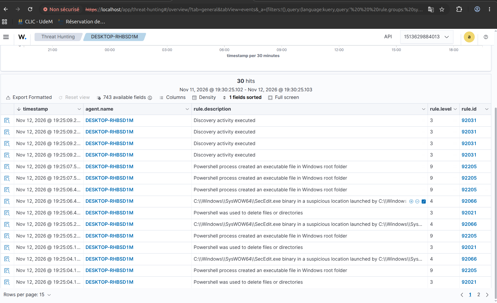
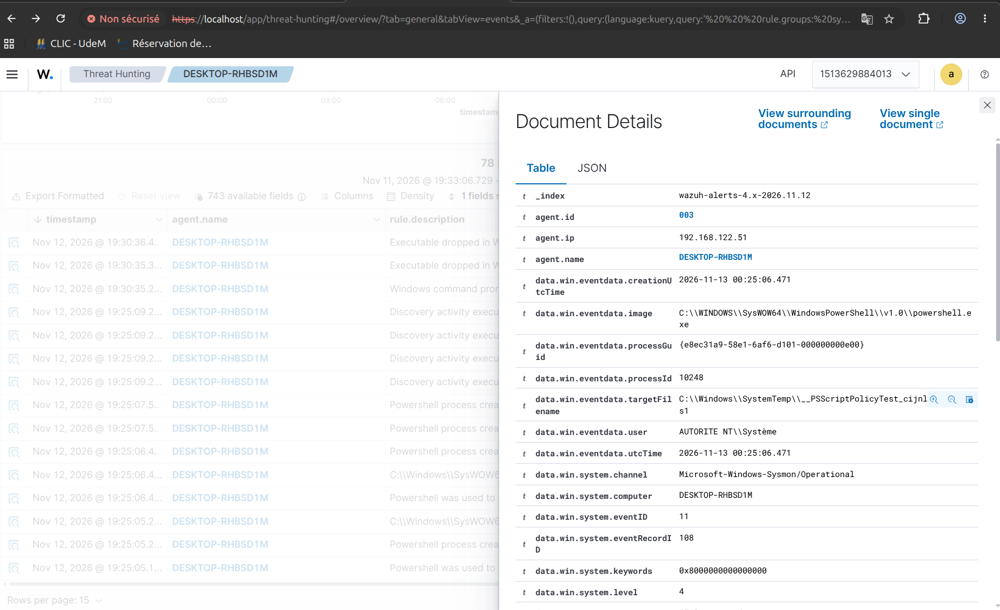
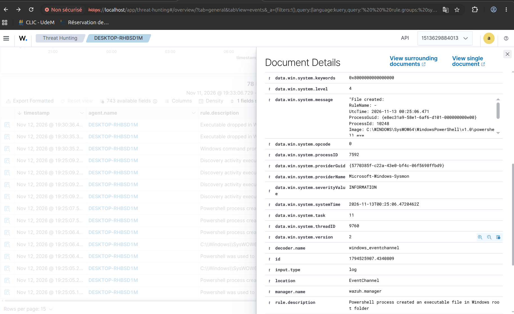
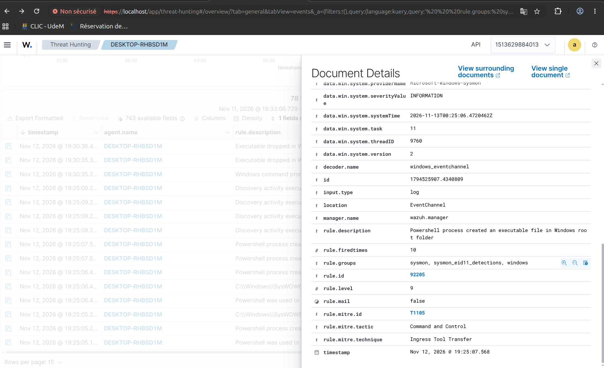

# Scénario 00 – Validation de la télémétrie et premier faux positif

**Date :** 2026-11-12
**Machine :** Windows 11 (DESKTOP-RHBSD1M, agent 003, 192.168.122.51)

## 1. Contexte

Avant de simuler des attaques, il faut s'assurer que la victime remonte assez d'informations au SIEM. Les journaux Windows de base ne montrent ni les créations de processus détaillées ni les connexions réseau. J'ai donc installé **Sysmon** (configuration SwiftOnSecurity) et configuré l'agent Wazuh pour collecter le canal `Microsoft-Windows-Sysmon/Operational`.

## 2. Mise en place

```powershell
Invoke-WebRequest https://download.sysinternals.com/files/Sysmon.zip -OutFile Sysmon.zip
Expand-Archive Sysmon.zip -DestinationPath Sysmon
Invoke-WebRequest https://raw.githubusercontent.com/SwiftOnSecurity/sysmon-config/master/sysmonconfig-export.xml -OutFile sysmon.xml
.\Sysmon\Sysmon64.exe -accepteula -i sysmon.xml
```

Ajout dans `C:\Program Files (x86)\ossec-agent\ossec.conf` :

```xml
<localfile>
  <location>Microsoft-Windows-Sysmon/Operational</location>
  <log_format>eventchannel</log_format>
</localfile>
```

## 3. Résultat

Requête dans Threat Hunting, filtrée sur l'agent 003 : `rule.groups: sysmon` → 30 événements dans les minutes qui suivent.



## 4. Investigation : alerte de niveau 9 sans attaque

Dès les premières minutes, plusieurs alertes sont apparues alors qu'aucune attaque n'était lancée :

| Règle | Niveau | Description | MITRE |
|-------|--------|-------------|-------|
| 92205 | 9 | Powershell process created an executable file in Windows root folder | T1105 – Ingress Tool Transfer |
| 92066 | 4 | SecEdit.exe binary in a suspicious location launched by … | — |
| 92021 | 3 | Powershell was used to delete files or directories | — |
| 92031 | 3 | Discovery activity executed | — |

Détail de l'alerte 92205 (Sysmon Event ID 11, création de fichier) :

| Champ | Valeur |
|-------|--------|
| Processus | `C:\WINDOWS\SysWOW64\WindowsPowerShell\v1.0\powershell.exe` |
| Fichier créé | `C:\Windows\SystemTemp\__PSScriptPolicyTest_*.ps1` |
| Utilisateur | `AUTORITE NT\Système` |





**Analyse :**

- Le fichier `__PSScriptPolicyTest_*.ps1` est un fichier temporaire que PowerShell crée lui-même pour tester la politique d'exécution des scripts. Il est créé puis supprimé aussitôt, ce qui explique les alertes 92021 (suppression de fichiers) juste après.
- Le PowerShell est la version **32 bits** (`SysWOW64`) et tourne en **SYSTEM**. L'agent Wazuh est lui-même un service 32 bits qui tourne en SYSTEM.
- `SecEdit.exe` (32 bits) est lancé à la même seconde. SecEdit sert à exporter la politique de sécurité locale, ce que fait le module SCA (Security Configuration Assessment) de Wazuh pour vérifier la conformité du poste.

**Conclusion :** faux positif très probable. L'activité vient du scan SCA de l'agent Wazuh, qui s'est lancé au redémarrage du service. Pour confirmer : vérifier que le processus parent est `wazuh-agent.exe` (champ `parentImage` des événements Sysmon ID 1) et que les alertes reviennent à l'intervalle du scan SCA.

## 5. Leçons apprises

- Un SIEM fraîchement déployé génère du bruit, y compris à cause de ses propres composants.
- Un niveau 9 ne veut pas dire « attaque » : c'est le contexte (processus, utilisateur, fichier créé, parent) qui tranche.
- Piste d'amélioration : une règle d'exception ciblée pour `__PSScriptPolicyTest_*.ps1` créé par SYSTEM, plutôt que de désactiver la règle 92205, qui reste utile contre un vrai dépôt d'outil.
