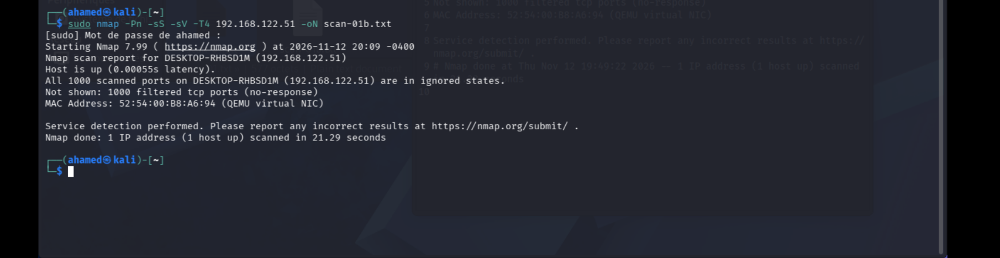
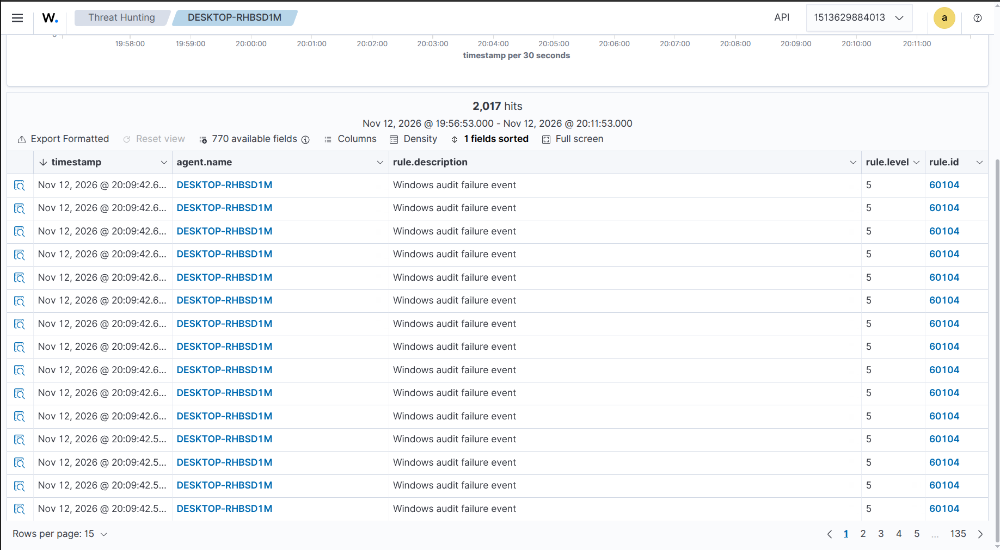
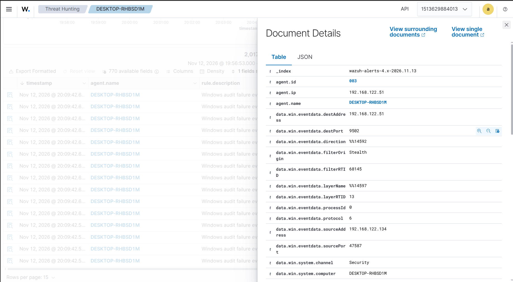
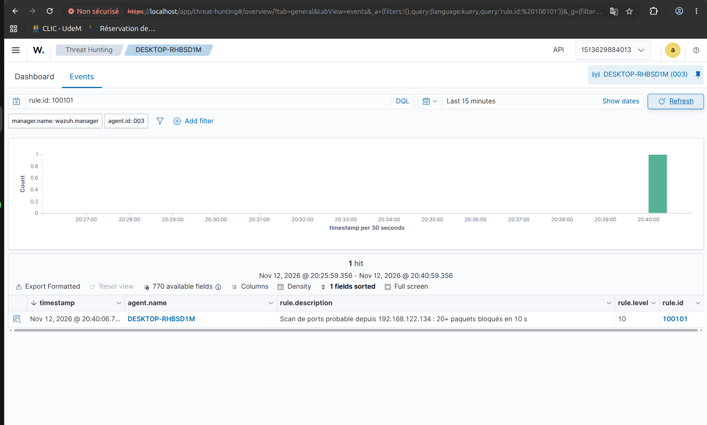

# Scénario 01 – Reconnaissance réseau avec nmap

**Technique MITRE ATT&CK :** T1046 – Network Service Discovery
**Date :** 2026-11-12
**Machines :** Kali 192.168.122.134 (attaquant) → Windows 11 192.168.122.51 (victime, agent 003)

## 1. Contexte

La reconnaissance est presque toujours la première étape d'une intrusion : l'attaquant cartographie la machine cible pour savoir quels services sont exposés. Un scan de ports qui passe inaperçu laisse l'attaquant préparer la suite sans que personne ne s'en rende compte.

## 2. Exécution de l'attaque

```bash
ping -c 3 192.168.122.51
sudo nmap -Pn -sS -sV -T4 192.168.122.51 -oN scan-01.txt
```

- Ping : 100 % de perte. Le pare-feu Windows (profil Public) bloque l'ICMP.
- nmap : les 1000 ports sont « filtered ». Le pare-feu ignore les paquets sans répondre (mode furtif).
- L'hôte est quand même détecté « up », avec son adresse MAC et le fabricant de la carte (QEMU). Comme Kali et Windows sont sur le même segment, nmap utilise l'ARP, que le pare-feu ne peut pas bloquer. L'attaquant apprend donc que la machine existe, et que c'est une VM.



## 3. Détection : état initial

Avec la configuration par défaut, **Wazuh ne voit rien du scan**. Deux raisons :

1. Windows ne journalise pas les paquets bloqués par le pare-feu (sous-catégorie d'audit désactivée).
2. L'agent Wazuh exclut explicitement les événements 5152 et 5157 dans sa requête sur le journal Security, parce qu'ils sont très bruyants.

## 4. Rendre le scan visible

Activation de l'audit sur la victime. Les noms des sous-catégories étant traduits sur un Windows en français, on passe par leurs GUID :

```powershell
auditpol /set /subcategory:"{0CCE9225-69AE-11D9-BED3-505054503030}" /failure:enable   # Filtering Platform Packet Drop
auditpol /set /subcategory:"{0CCE9226-69AE-11D9-BED3-505054503030}" /failure:enable   # Filtering Platform Connection
```

Retrait de l'exclusion dans `ossec.conf` de l'agent : `EventID != 5152 and EventID != 5157` remplacé par `EventID != 0` pour garder la requête XPath valide.

Résultat après un nouveau scan : **2017 alertes « Windows audit failure event » (règle 60104, niveau 5)**, toutes dans la même seconde.



Chaque alerte correspond à un événement 5152 (paquet bloqué), avec l'IP source, le port visé et le filtre `Stealth` :



Le scan est techniquement visible, mais inexploitable : un analyste voit 2000 alertes génériques de niveau moyen et rien qui dise « cette machine est en train d'être scannée ».

## 5. Amélioration de la détection

Règles personnalisées : [`detections/scan_ports_rules.xml`](../detections/scan_ports_rules.xml)

| Règle | Niveau | Rôle |
|-------|--------|------|
| 100100 | 2 | Attrape chaque 5152/5157 (enfant de 60104). Sous le seuil d'alerte : plus de bruit dans le dashboard, mais l'événement est mémorisé pour la corrélation. |
| 100101 | 10 | 20 événements 100100 ou plus depuis la même IP source en 10 secondes → « Scan de ports probable ». `ignore="60"` : une alerte par minute maximum. Mappée T1046. |

### Débogage

La première version ne déclenchait jamais la 100101 :

1. **100100 au niveau 0.** Elle faisait bien taire le bruit (plus aucune 60104 pendant les scans), mais un événement classé au niveau 0 est abandonné par le moteur avant d'être mémorisé pour `if_matched_sid`. La règle de corrélation comptait dans une liste toujours vide. Correction : niveau 2.
2. **Mauvaise version déployée.** Un premier redéploiement a copié l'ancien fichier dans le conteneur. Repéré en vérifiant le contenu dans le conteneur (`grep 'rule id'`) avant le redémarrage du manager, une étape désormais systématique.
3. **Fausse piste.** `wazuh-logtest` en ligne de commande ne reproduit pas le canal EventChannel de l'agent : les événements de test tombaient dans la règle générique 1002. L'outil n'était pas fiable pour ce cas, d'où le passage à des tests réels avec nmap.

Pour isoler le problème, chaque étage a été vérifié séparément : production des événements sur Windows (`Get-WinEvent`, 4005 événements 5152), réception et classement par le manager, puis corrélation.

## 6. Résultat

Même scan, après correction : **une seule alerte de niveau 10**, qui nomme l'IP de l'attaquant.



| | Avant | Après |
|---|---|---|
| Alertes pour un scan | 0 (défaut) puis ~2000 de niveau 5 | 1 de niveau 10 |
| Information utile | Aucune / noyée | IP source, technique T1046 |

## 7. Réponse

Ce qu'un analyste ferait face à cette alerte :

- Identifier la source : 192.168.122.134 est-elle une machine connue (scanner de vulnérabilités autorisé, admin) ?
- Si elle est inconnue : bloquer l'IP au pare-feu, puis chercher dans Wazuh toute autre activité de cette IP (authentifications, connexions réussies) pour savoir si le scan a été suivi d'une tentative d'accès.
- Escalader si la source est interne et non autorisée : une machine compromise sur le réseau est plus grave qu'un scan venu d'Internet.

## 8. Leçons apprises

- Un pare-feu bien configuré cache les services, mais pas l'existence de la machine sur un réseau local (ARP).
- Une configuration par défaut peut rendre une attaque totalement invisible. Il faut savoir quelles sources de journaux sont actives, et pourquoi certaines sont exclues.
- Activer une source bruyante sans corrélation remplace un angle mort par un mur de bruit. La valeur vient de la règle qui transforme 2000 événements en une alerte.
- Vérifier ce qui est réellement déployé avant de déboguer la logique.

**Limites :** le seuil (20 paquets en 10 s) ne détecte pas un scan lent (`-T1`, `-T0`) ni un scan distribué sur plusieurs IP sources. Une règle complémentaire avec une fenêtre plus longue et un seuil plus bas serait nécessaire.
